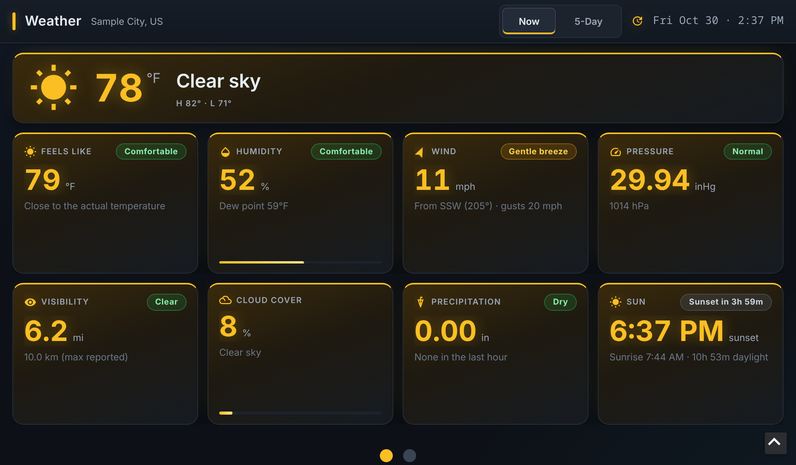
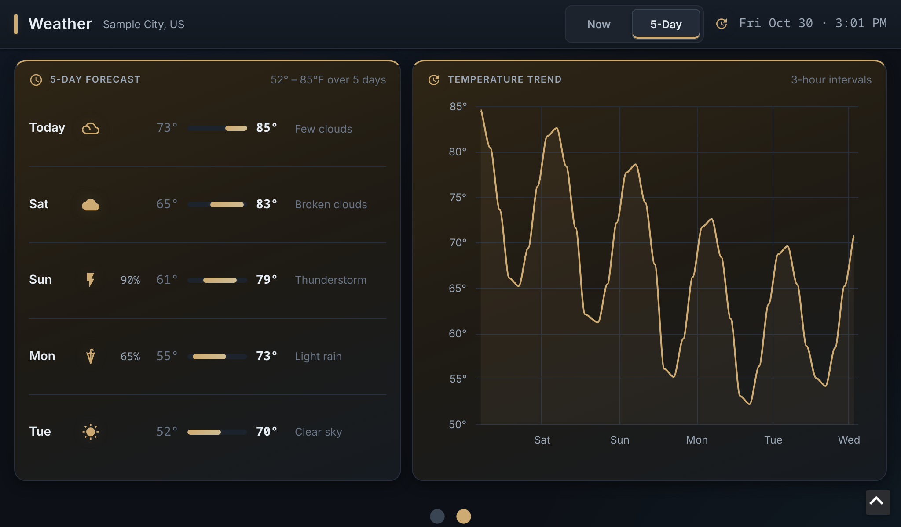

# WeatherApp

An Ignition Perspective weather dashboard driven by the [OpenWeather](https://openweathermap.org/) API.
It shows current conditions and a 5-day forecast in a touch-friendly carousel sized for a
1024×600 display, and scales evenly to fill larger screens up to 4K.

| Now | 5-Day |
|---|---|
|  |  |

<sub>Screenshots use made-up data for a fictional "Sample City".</sub>

- **Now**: current temperature and condition, plus KPI cards for feels-like, humidity and dew point,
  wind, pressure, visibility, cloud cover, precipitation and sunrise/sunset. Each card has a
  severity badge (green, amber or red).
- **5-Day**: one row per day with the low/high on a shared temperature scale and the chance of
  precipitation, plus a 3-hourly temperature trend chart you can tap for values.
- The color theme follows the current weather (clear, cloudy, rain, storm, snow, night, hot, cold, windy).
- Switch tabs by swiping, tapping **Now | 5-Day** in the header, or tapping the dots. The
  carousel also advances every 15 seconds and pauses while you interact with it.

Built and tested on **Ignition 8.3.10** with the Perspective module.

---

## 1. Get an OpenWeather API key

The scripts call two OpenWeather endpoints, and both are included in the **free plan**
(60 calls/minute, 1,000,000 calls/month). This project makes about 26 calls a day.

| Endpoint | Used for | Called |
|---|---|---|
| `api.openweathermap.org/data/2.5/weather` | Current conditions (Now tab) | Every hour, and on project startup |
| `api.openweathermap.org/data/2.5/forecast` | 5-day / 3-hour forecast (5-Day tab) | 00:00 and 12:00, and on project startup |

1. Create a free account at <https://home.openweathermap.org/users/sign_up> and confirm your email.
   OpenWeather emails you your first API key.
2. You can also see or create keys any time on the **API keys** tab:
   <https://home.openweathermap.org/api_keys>.
3. **A new key can take a while to start working** (often a couple of hours). Until it does, requests
   fail with an "invalid API key" error, usually HTTP 401. If you get that straight after signing up,
   wait and try again before suspecting your setup.

> **Treat the key like a password.** Don't paste it into scripts, views or tags, and never commit it.
> This project reads it from Ignition's encrypted secret store at runtime, so it is never part
> of the project files.

## 2. Store the key in Ignition

The `weather` script reads the key with:

```python
apiKey = system.secrets.readSecretValue('Default', 'openWeather').getSecretAsString()
```

That means the gateway needs an **internal secret provider named `Default`** containing a **secret
named `openWeather`**:

1. Open the Gateway web page (for example `http://<gateway>:8088`) and sign in as an administrator.
2. Go to the **Secret Providers** settings (under **Platform → Security** in 8.3; menu names vary
   slightly between versions).
3. If there's no provider called `Default`, create an **Internal** provider with that name.
4. Add a secret to it named `openWeather`, paste your API key as the value, and save.

If you'd rather use different names, change the two arguments on line 1 of
`ignition/script-python/weather/code.py` to match.

The secret lives in the gateway's configuration, not in this project, so it is never exported or committed.

## 3. Create the tags and set the gateway's location

The scripts use four memory tags in the `[default]` tag provider. Tags are gateway configuration,
so they aren't in this repo, and neither is your location. Create them in the Designer's Tag
Browser, or import this JSON with **Tag Browser → Import Tags** while `[default]` is selected.
**Replace the two `0.0` values with your gateway's latitude and longitude** first, or edit the
tags afterwards:

```json
{
  "name": "openWeather",
  "tagType": "Folder",
  "tags": [
    { "name": "hourlyWeather", "tagType": "AtomicTag", "valueSource": "memory", "dataType": "Document" },
    { "name": "fiveDayReport", "tagType": "AtomicTag", "valueSource": "memory", "dataType": "Document" },
    { "name": "location", "tagType": "Folder", "tags": [
      { "name": "latitude",  "tagType": "AtomicTag", "valueSource": "memory", "dataType": "Float8", "value": 0.0 },
      { "name": "longitude", "tagType": "AtomicTag", "valueSource": "memory", "dataType": "Float8", "value": 0.0 }
    ]}
  ]
}
```

| Tag | Holds |
|---|---|
| `[default]openWeather/location/latitude` | Gateway latitude, decimal degrees (-90 to 90) |
| `[default]openWeather/location/longitude` | Gateway longitude, decimal degrees (-180 to 180) |
| `[default]openWeather/hourlyWeather` | Current-weather response (Now tab) |
| `[default]openWeather/fiveDayReport` | 5-day forecast response (5-Day tab) |

To find your coordinates, right-click a spot in Google Maps and click the numbers at the top of
the menu to copy them, or use OpenWeather's
[Geocoding API](https://openweathermap.org/api/geocoding-api) with a city name. For example,
latitude `40.71` and longitude `-74.01`. Two decimal places (about 1 km) is plenty for weather.

The `weather` script reads the location tags on every fetch, so a change takes effect at the next
scheduled update, or straight away if you save the project (saving reruns `onStartup`). If the tags
are missing, bad quality, out of range, or still `0.0, 0.0`, the script **skips the API call** and
logs a warning from the `weather` logger instead of fetching weather for the wrong place.

## 4. Units

The dashboard expects `units=imperial` (°F, mph), which is set in `weather/code.py`. The scripts
convert pressure, visibility and precipitation themselves, so leave it as it is.

## 5. Install the project

1. Copy the `Home-Lab` folder into the gateway's projects directory, for example
   `/usr/local/bin/ignition/data/projects/` in the official Docker image.
   You can rename the folder; the folder name is the project name.
2. Make the gateway load it: restart the gateway, or in 8.3 trigger a project scan with
   `POST /data/api/v1/scan/projects` and an API token that has write access.
3. Open the project in a browser at `http://<gateway>:8088/data/perspective/client/Home-Lab`.
   The dashboard is mounted at the page URL `/`.

## 6. Check it's working

- Project **startup** (and every project save, because saving restarts gateway scripts) calls
  `weather.getFiveDay()` and `weather.getCurrentWeather()`, so both tags fill straight away.
- After that, two gateway scheduled scripts keep the data fresh:
  - `weatherUpdate` runs every hour (`0 * * * *`).
  - `5dayReport` runs at midnight and noon (`0 0,12 * * *`).
- If the tags stay empty or the dashboard shows **No data**:
  - **HTTP 401 / invalid API key**: the key isn't active yet, or the secret's value is wrong.
  - **Secret not found**: check the provider (`Default`) and secret (`openWeather`) names.
  - **"Location not set" / "out of range" warnings, or the wrong city**: check the
    `openWeather/location` tags. They may still be `0.0`, or latitude and longitude may be swapped.
  - Look in the gateway logs (the Gateway web page's diagnostics/logs section, or `docker logs`
    for a container) for errors from the `weather` script.
  - The `weather.weatherReport()` helper returns the HTTP status code and the response body. If a
    call fails, the tag keeps its previous value.

## Project layout

```
Home-Lab/
├── ignition/
│   ├── script-python/
│   │   ├── weather/        # OpenWeather URLs, key lookup, writes the tags
│   │   └── API/            # small system.net.httpClient GET wrapper
│   ├── scheduled/          # weatherUpdate (hourly), 5dayReport (twice daily)
│   ├── startup/            # fetches both reports when the project starts
│   └── shutdown/
└── com.inductiveautomation.perspective/
    ├── views/
    │   ├── weatherDashboard/   # page view: header, Now|5-Day toggle, carousel, data processing
    │   └── weather/
    │       ├── Current/        # Now tab (KPI cards)
    │       └── Forecast/       # 5-Day tab (daily rows + trend chart)
    ├── stylesheet/             # dark theme, weather-* color classes, viewport scaling (section 13)
    ├── page-config/
    └── session-props/
```

`weatherDashboard` turns each tag into display-ready values with a script transform, stored in
`view.custom.kpi` and `view.custom.fc`. It passes those to the two tab views as parameters, so the
processing logic lives in one place.

## Screen sizes

The views are sized in `rem`, and section 13 of `stylesheet.css` sets the root font size from the
viewport: 1rem = 14px at 1024×600, scaling with whichever dimension is tighter (from 9px up to
56px). The whole dashboard therefore scales as one unit, from small kiosk panels with browser
toolbars up to 3840×2160, without scrollbars.
